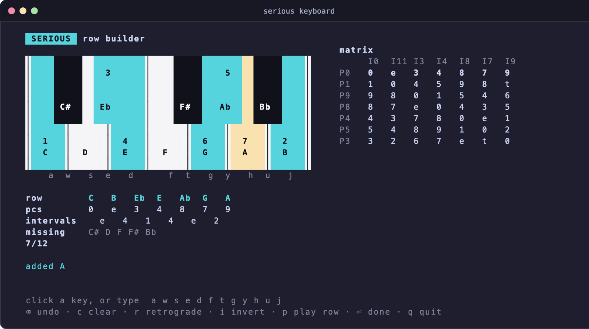
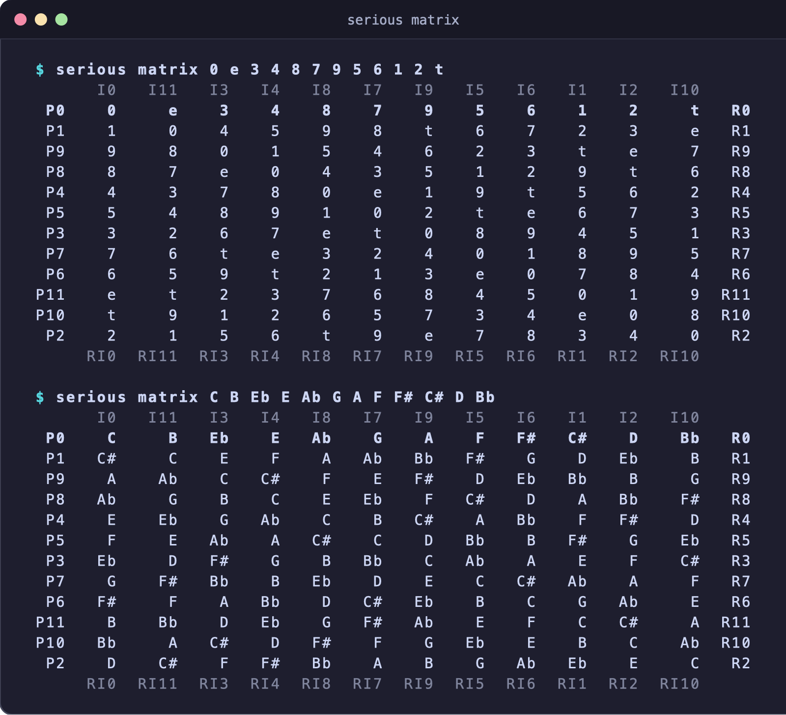

# Serious

Computer-aided composition on the command line, focusing on serial manipulations, pitch-class analysis, and spectral/rhythm tools — aimed at quick sketching of musical ideas.

> **Status: Alpha.** Serious is currently in an experimental alpha state; commands, flags, and output formats may change.

Write pitches however you like — `F#4`, `Bb`, `66`, `6600`, `369.99hz`, `fis'`,
`Fa#4`, `pc:6`, `C4+31c` — and Serious answers **in the same notation**, unless
you ask for another one with `--to`.

## At a Glance

- **Fortean pitch-class set analysis:** normal & prime form, Forte name, interval vector, complement, Z-partner, and invariance (`serious set 0 1 4 6`, `serious matrix 0 e 3 4 8 7 9 5 6 1 2 t`)
- **Classic serial transformations:** `serious transpose M3 Eb4 G4 Bb4`, `serious invert --axis E4 C4 D4 G4`, `serious retrograde …`, `serious rotate -n 2 …`
- **Accepts & translates any pitch format:** note names, microtonal cents, MIDI, midicents, pitch classes, Hz, LilyPond, Helmholtz, and solfège (`serious F#4 440hz 6250` or `serious convert C E G --to midi`)
- **Spectral tools:** harmonic/undertone series and stretched/compressed overtone series (`serious harmonics C2 16 --stretch 1.05 --approx 4`), plus ring and FM modulation (`serious ring …`, `serious fm C4 G4 --index 3`)
- **Interactive keyboard:** click or type a 12-tone row on a terminal piano (`serious keyboard`) and pipe it straight into other commands (`serious keyboard | serious matrix`)
- **Rhythm & isorhythm:** Euclidean rhythms, Messiaen non-retrogradable palindromes and added values, augment/diminish, and multi-voice isorhythm (`serious isorhythm --color "C4 E4 D4 F#4 Bb4" --talea "q e. s q"`)
- **Command-line playback & cross-platform export:** add `--play` to hear any command through the built-in synth, or `--out` to export `.mid`, `.ly` (LilyPond), `.musicxml`, `.mxl`, `.wav`, or `.txt`

```console
$ serious set 0 1 4 6
pitch classes    {0,1,4,6}
normal form      [0,1,4,6]
prime form       (0146)
Forte name       4-Z15A
interval vector  <111111>
complement       {2,3,5,7,8,9,t,e}   [8-Z15]
Z-related to     4-Z29
invariant under  T0
```





```console
$ serious transpose M3 Eb4 G4 Bb4
G4 B4 D5
$ serious transpose 7 60 64 67
67 71 74
$ serious transpose -m3 "fis'"
dis'
$ serious F#4 Bb 6250 440hz "cis'" Do#4 C4+31c
input   name    midi   mc    pc    hz        lily  solfege
F#4     F#4     66     6600  6     369.99Hz  fis'  Fa#4
Bb      Bb      70     7000  10    466.16Hz  bes   Sib
6250    D4+50c  62.5   6250  2.5   302.27Hz  dih'  Re4+50c
440hz   A4      69     6900  9     440Hz     a'    La4
cis'    C#4     61     6100  1     277.18Hz  cis'  Do#4
Do#4    C#4     61     6100  1     277.18Hz  cis'  Do#4
C4+31c  C4+31c  60.31  6031  0.31  266.35Hz  cih'  Do4+31c
```

## Installation

From the project folder:

```sh
python3 -m venv .venv
.venv/bin/pip install -e .
```

Then either run `.venv/bin/serious`, or activate the environment
(`source .venv/bin/activate`) and just type `serious`. Because the install is
editable (`-e`), changes to the code take effect immediately.

You can also run it without installing: `python3 -m serious …`.

Audio playback (`--play`, `serious play`, `serious keyboard`) requires a command-line player on your PATH (`afplay` on macOS, `paplay` or `aplay` on Linux, or `ffplay` from FFmpeg; Windows uses `winsound`, and `serious keyboard` on Windows requires `pip install windows-curses`).

## Notations

Serious reads all of these, and you can mix them in one command
(`serious formats` prints this list):

| notation | examples | notes |
|---|---|---|
| note names | `C` `F#` `Bb` `Ebb` `Cx` `C##` `F♯4` `E♭` `c#4` `Csharp` `E-flat` | `C4` = middle C (scientific octaves). A name without an octave is a pitch class. German `H` = B. |
| microtones | `C4+50c` `Bb3-14c` `A4+31¢` | cents after the note; quarter tones also as `C𝄲`, `Cqs`, `cih` |
| LilyPond | `c'` `fis''` `bes` `es` `as` `cisih` | Dutch names, `c'` = middle C |
| Helmholtz | `c` `c'` `c''` | uppercase `C` = C2 |
| solfège | `Do` `Re` `Mi` `Fa` `Sol` `La` `Si`/`Ti`, `Do#4`, `Sib3`, `Ré`, `Ut` | fixed do |
| MIDI | `60` `61.5` | numbers below 128; decimals are microtones |
| midicents | `6000` `6150` `6150mc` | numbers 128 and above, or with `mc` |
| pitch classes | `0 4 7` `t e` | a list made only of 0–11 / `t` / `e` is read as pitch classes |
| frequency | `440hz` `261.63Hz` `1.2kHz` `"440 Hz"` | |

Separators can be spaces, commas, semicolons, brackets or pipes, so you can
paste `[0, 4, 7]` or `<c e g>` directly.

### Ambiguities and how to force a reading

Some inputs could mean more than one thing. Serious picks a default for each,
and you can always override it:

- **`7` alone, or `0 4 7`**: read as pitch classes, because MIDI notes 0–11 are
  below the range of hearing. Use `midi:7` or `--from midi` to mean MIDI notes.
- **Commas**: they separate pitches (`C, E, G`). To use LilyPond/Helmholtz commas
  as octave marks (`c,,`), write `ly:c,,` or pass `--from lily`. In that mode
  LilyPond durations are ignored too (`c'4.`).
- **`es` / `as`**: read as E♭ / A♭ (Dutch/German), not LilyPond-English E♯ / A♯.
- **Uppercase `B`**: English B natural. Write German B♭ as `Bb` or `bes`.
- **Octave numbers**: middle C is `C4` by default. Use `--middle-c 3` for the
  Yamaha/Logic convention.

Per-token prefixes force one reading for a single pitch: `midi:7`, `pc:7`,
`mc:6000`, `hz:440`, `ly:c,,`, `name:…`. `--from FORMAT` applies one to every
pitch.

### Output

By default, results are written in the notation of the input. If the input mixes
notations, they come out as note names. `--to` (or `-t`) chooses one:
`name`, `midi`, `mc`, `pc`, `hz`, `lily`, `solfege`, or `all` for a table.

Other options, available on every command:

| option | meaning |
|---|---|
| `--sharps` / `--flats` | how to spell black keys (default: C# Eb F# Ab Bb) |
| `--approx N` | round output to 1/N tone, as in OpenMusic: `2` semitones, `4` quarter tones, `8` eighth tones |
| `--a4 HZ` | tuning reference (default 440) |
| `--middle-c N` | octave number of middle C (default 4) |
| `--from FORMAT` | read every pitch as `name`, `midi`, `mc`, `pc`, `hz` or `lily` |

Where the input has a spelling (`Db` as opposed to `C#`), Serious keeps it.
When you transpose by a *named* interval, it spells the result properly too:
`transpose M3 C#4` gives `E#4`, not `F4`.

## Commands

Run `serious <command> --help` for the details of any command. If you leave the
command out, Serious runs `convert`: `serious F#4` shows F#4 in every notation.

### Converting

```console
$ serious convert C E G --to midi
60 64 67
$ serious 440hz 6150 --to name
A4 C#4+50c
```

### Transformations

| command | |
|---|---|
| `transpose INTERVAL …` (`t`) | intervals: `7`, `-3`, `1.5`, `700c`, `3/2`, `5:4`, `P5`, `-m3`, `M10`, `A4`, `d7`, `TT` |
| `invert …` (`i`) | mirror around `--axis PITCH` (default: the first pitch) |
| `retrograde …` (`r`) | reverse the order |
| `rotate -n N …` | rotate the order N places left |

```console
$ serious invert --axis E4 C4 D4 G4
Ab4 F#4 C#4
$ serious transpose 3/2 A4 --to hz
660Hz
```

Negative intervals work as written (`transpose -m3 …`, `transpose -700c …`).

### Analysis

```console
$ serious intervals C4 E4 G4 C5
from     to  semitones  interval
C4    →  E4  +4         M3 ↑
E4    →  G4  +3         m3 ↑
G4    →  C5  +5         P4 ↑

$ serious set 0 1 4 6
pitch classes    {0,1,4,6}
normal form      [0,1,4,6]
prime form       (0146)
Forte name       4-Z15A
interval vector  <111111>
complement       {2,3,5,7,8,9,t,e}   [8-Z15]
Z-related to     4-Z29
invariant under  T0

$ serious chord C E G A
C6   (also Am7/C)
set class 4-26 (0358)
```

- `intervals`: the intervals between successive pitches. For pitches without
  octaves it gives ordered pitch-class intervals and interval classes.
  `--semitones` prints just the numbers.
- `set`: pitch-class set analysis. It covers the normal form, prime form, Forte
  name (with A/B for inversion type), interval vector, complement, Z-partner and
  symmetries. Prime forms use Rahn's algorithm, as in most current textbooks and
  software. It differs from Forte's original table only for 5-20, 6-Z29, 6-31,
  7-Z18, 7-20 and 8-26. The Forte names are the same either way.
- `matrix` (`row`): a twelve-tone matrix with P/I/R/RI labels. Labels name the
  starting pitch class; use `--zero` to call the given row P0.
- `chord`: give several pitches to name the chord, or one chord symbol to spell
  it. Examples: `Cmaj7`, `F#m7b5`, `Bb7/D`, `Eb6/9`. Use `--octave` to set the
  register.
- `scale ROOT NAME`: modes, harmonic/melodic minor, pentatonics, whole tone,
  octatonic, Messiaen modes and more (`serious scale --list`). Seven-note
  scales are spelled with one letter per degree (`scale F# major` → `… E#`).

### Generators

```console
$ serious improvise
G B C Ab F F# Eb Bb E C# A D
$ serious improvise --all-interval --to pc
5 1 3 8 0 7 6 9 10 4 2 11
$ serious infinity 16 --start G3
G3 Ab3 F#3 A3 Ab3 G3 F3 Bb3 F#3 A3 G3 Ab3 A3 F#3 E3 B3
```

- `improvise` (`random`): a random twelve-tone row. Each run gives a different
  one; your output will differ from the example above.
  - `--all-interval`: a random row whose 11 successive intervals are all
    different.
  - `--first E`: start the row on E.
  - `--count 5`: five rows, one per line.
  - `--seed 42`: the same "random" rows every time.
- `infinity [LENGTH]` (`norgard`): Per Nørgård's infinity series. The series is
  a(0) = 0, a(2n) = −a(n), a(2n+1) = a(n) + 1, read as steps from a starting
  note.
  - `--start` sets the first note (default C4; Nørgård often began on G).
  - `--step` sets the size of each step: `1` semitone (the default), `2`
    whole tones, `m3`, `50c` quarter tones, and so on.
  - The series is self-similar: every fourth note gives the series again, and
    every second note gives its inversion.

They combine with everything else:

```sh
serious improvise --all-interval | serious matrix
serious improvise --play
serious infinity 64 --start G3 --play --dur 0.15
serious infinity 32 --step 50c --to mc
```

### Spectral tools

```console
$ serious harmonics C2 8 --approx 4
partial  Hz      name    midi  mc
1        65.41   C2      36    3600
2        130.81  C3      48    4800
3        196.22  G3      55    5500
4        261.63  C4      60    6000
5        327.03  E4      64    6400
6        392.44  G4      67    6700
7        457.84  A4+50c  69.5  6950
8        523.25  C5      72    7200
```

- `harmonics FUNDAMENTAL [COUNT]`: the harmonic series. `--sub` gives the
  undertone series. `--stretch S` gives a distorted spectrum, where partial
  k = f·k^S.
- `ring …`: ring modulation, the sum and difference tones of every pair of
  pitches.
- `fm CARRIER MODULATOR -i INDEX`: an FM spectrum, c ± k·m for k up to the
  index. Negative frequencies fold back.

The Hz column always shows the exact frequency; `--approx` rounds the pitches.
For `set`, `matrix` and `chord`, `--approx` rounds the *input*, so microtonal
material (spectra, say) can be analysed as its nearest 12-tone pitches.
Add `--to midi`, `--to mc` and so on to get a single line you can pipe on.

## Rhythm

Rhythms work like pitches: write durations in any notation and Serious answers
in the same one.

```console
$ serious rhythm q e. s q h
input  fraction  lily  name  beats  ms
q      1/4       4     q     1      500ms
e.     3/16      8.    e.    0.75   375ms
s      1/16      16    s     0.25   125ms
q      1/4       4     q     1      500ms
h      1/2       2     h     2      1000ms

length      5/4 = 5 beats = 2.5 s at ♩ = 120
in 4/4      1 bar + 1/4
onsets      1:1 1:2 1:2.75 1:3 1:4   (bar:beat)
pattern     x...x..xx...x.......   (pulse 1/16)
palindrome  no
```

| notation | examples | notes |
|---|---|---|
| names | `w h q e s t`, `q.` `e..`, `e3` (triplet eighth), `s5` | also words: `quarter`, `dotted-quarter`, `triplet-eighth`, `crotchet`, `quaver`… |
| fractions | `1/4` `3/8` `1/12` | of a whole note |
| LilyPond | `4.` `8` `16` `8*2/3` `16*5` | see below |
| beats | `1` `0.5` `1.5` | bare numbers; quarter note = 1 |
| time | `250ms` `0.5s` | at `--tempo` |
| patterns | `x..x..x.` | `x` = onset, `.` = one pulse; the pulse is `--pulse` (default 1/16) |
| proportions | `3:2:2:1` | in pulses |
| rests | `rq` `r1/8` `r4.` `..x` | `r` before any duration, or leading dots in a pattern |

Barlines (`|`), commas and brackets are ignored, so `"q e e | h"` is fine.
Durations are exact fractions, so tuplets and long augmentations never drift.

**Bare numbers are beats.** `4 8 8 2` means 4 beats, 8 beats… Once a
rhythm contains an unmistakable LilyPond duration (`4.` or `8*2/3`), bare
powers of two are read as LilyPond durations too. Otherwise use
`--from lily`, or names (`q e e h`).

### Rhythm operations

All of these live under `serious rhythm` (alias `rh`); `serious rhythm -h`
lists them.

```console
$ serious rhythm augment 3/2 q e e
q. e. e.
$ serious rhythm diminish 2 4. 8 4
8. 16 8
$ serious rhythm euclid 5 8
x.xx.xx.
$ serious rhythm euclid 3 8 --to name
e. e. e
$ serious rhythm palindrome s e q.
s e q. e s
$ serious rhythm add-value dot --at 2 q q q
q q. q
$ serious rhythm infinity 8
xx.x.x..x.xx..x...
```

| operation | |
|---|---|
| `show` | every notation, plus length, bar positions (`--meter 3/4`), pattern and symmetry. This is the default: `serious rhythm q e e` is `serious rhythm show q e e`. |
| `augment RATIO` / `diminish RATIO` | multiply or divide every duration: `2`, `3/2`, `1.5`… |
| `retrograde`, `rotate -n N` | reverse, or rotate N places left |
| `palindrome` | Messiaen's non-retrogradable rhythm: the durations, a centre (`--centre q.`, default the last duration), then the durations backwards |
| `add-value VALUE` | Messiaen's added value: insert a short note (`s`) or rest (`rs`) before duration `--at N` (default the end), or `add-value dot --at N` to dot duration N |
| `euclid K N` | K onsets spread as evenly as possible over N pulses (Bjorklund's algorithm, as in Toussaint's Euclidean rhythms); `--rotate` shifts it |
| `infinity [N]` | durations of \|a(n)\|+1 pulses from Nørgård's infinity series. Every other duration repeats the whole rhythm. |

Patterns come out as patterns. If an operation pushes a pattern off its pulse
grid (`augment 3/2 x..x..x.`), the result is written as fractions instead.

### Hearing rhythms

Every rhythm operation takes `--play`. Rhythms play on a single pitch,
`--on PITCH` (default C5), at `--tempo BPM` (quarter notes per minute,
default 120).

To give pitches a rhythm, add `--rhythm` to any command that plays. The rhythm
repeats as often as needed, and rests take time without using up a pitch:

```sh
serious play C4 E4 G4 C5 --rhythm "q e e" --tempo 90
serious scale D dorian --play --rhythm "e. s"
serious chord Cmaj7 --play --rhythm "q q h"      # the chord on every duration
serious improvise --play --rhythm "$(serious rhythm euclid 5 8)"
```

## Isorhythm: pitch series against rhythm series

`serious isorhythm` runs a pitch series (the *color*) against a rhythm series
(the *talea*), like a medieval motet or Messiaen. When the two have different
lengths they drift against each other. They only start together again after
the least common multiple of their lengths, which is a long time when both
lengths are prime. Give several `--color`/`--talea` pairs for several voices.
A color can contain chords: `"C4 <E4 G4> D4"`.

Messiaen's *Liturgie de cristal* (the first movement of the *Quartet for the
End of Time*) is usually described like this: the piano runs a color of **29
chords** against a talea of **17 durations**, so they realign only after
17 × 29 = 493 notes, and the cello runs **5 pitches** against **15
durations**. Here is that structure with stand-in material. The piano gets 29
notes of Nørgård's infinity series instead of Messiaen's chords, against a
17-value non-retrogradable rhythm:

```console
$ serious isorhythm \
    --color "$(serious infinity 29 --start C4)" \
    --talea "$(serious rhythm palindrome s e s e. q s e. e --centre q.)" \
    --color "C3 E3 D3 F#3 Bb3" \
    --talea "q e. e q. s s e q e. h e q e. s q"
voice 1: 29 pitches × 17 durations → they realign after 493 notes (17 × color, 29 × talea), 290 beats = 2:25 at ♩ = 120
C4:s C#4:e B3:s D4:e. C#4:q C4:s Bb3:e. Eb4:e B3:q. D4:e C4:e. C#4:s D4:q B3:e. A3:s E4:e …

voice 2: 5 pitches × 15 durations → they realign after 15 notes (3 × color, 1 × talea), 12 beats = 0:06 at ♩ = 120
C3:q E3:e. D3:e F#3:q. Bb3:s C3:s E3:e D3:q F#3:e. Bb3:h C3:e E3:q D3:e. F#3:s Bb3:q

all voices realign after 1740 beats = 14:30 at ♩ = 120
```

Add `--play` to hear it, or `--out liturgie.musicxml` (or `.mid`, `.ly`,
`.wav`…) to save it; see [Export](#export). The printout
shows one full cycle of each voice. When played, shorter voices keep cycling
until the longest one has finished. `--notes N` stops each voice after N
notes. If you have the score, put Messiaen's own chords and durations into
`--color` and `--talea`.

## Sound

Serious has a small built-in synthesizer, so you can hear what you're working
with. It plays exact frequencies, so microtones and spectra sound as written.

```sh
serious play C4 E4 G4 Bb4                  # one after another
serious play C4 E4 G4 Bb4 --chord          # together
serious transpose M3 C4 E4 G4 --play       # --play works on every command
serious harmonics C2 16 --play             # the partials as an ascending scale
serious harmonics C2 16 --play --chord     # the whole spectrum at once, at 1/k amplitude
serious fm C4 G4 -i 4 --play --wave sine
serious chord Cmaj9 --out cmaj9.wav        # write a WAV file instead (see Export for MIDI etc.)
serious harmonics A1 24 --to mc | serious play --chord --dur 6
```

With `--play`, a command plays its result, or for `intervals`, `set`, `matrix`
and `chord` the pitches it analysed. Chords, set analyses and the `ring` and
`fm` spectra sound together. Everything else plays as a melody, including
`harmonics`, which plays the series as a scale; add `--chord` to hear it as a
single sound.

| option | meaning |
|---|---|
| `--play` | play through the speakers (`serious play` always does) |
| `--out FILE` | write a file instead of (or as well as) playing: `.wav` is 44.1 kHz mono audio; see [Export](#export) for the other formats |
| `--wave` | `sine`, `triangle` (default), `square`, `saw`, `organ` |
| `--dur SECONDS` | length of each note (default: a quarter note, or a whole note for chords, at `--tempo`) |
| `--chord` / `--melody` | sound the pitches together / one after another |
| `--volume` | peak level from 0 to 1 (default 0.5) |
| `--rhythm DURATIONS` | play with this rhythm (see [Rhythm](#hearing-rhythms)) |
| `--tempo BPM` | quarter notes per minute for rhythms (default 120) |

The waveforms are band-limited, so high notes don't alias. `--approx` is
applied before playing, so you can hear the difference between a spectrum and
its quarter-tone or semitone approximation. Playback uses `afplay` on macOS;
on Linux it uses `paplay`, `aplay` or `ffplay`. Press Ctrl-C to stop.

## Export

Add `--out FILE` to any command that makes notes, and Serious writes what it
would play. The file extension picks the format. Repeat `--out` to write
several formats at once.

```sh
serious isorhythm --color "…" --talea "…" --out liturgie.mid --out liturgie.ly --out liturgie.musicxml
serious improvise --all-interval --rhythm "q e e" --out row.musicxml
serious harmonics C2 16 --chord --out spectrum.ly
serious rhythm euclid 5 8 --out tresillo.mid
```

| extension | format | what's in it |
|---|---|---|
| `.mid` / `.midi` | Standard MIDI file (type 1) | A tempo and meter track, then one track per voice. Microtones are exact: each microtonal note gets its own channel with a pitch bend (±2 semitones). Channel 10 (drums) is never used. |
| `.ly` | LilyPond | An engraved score; compile it with `lilypond file.ly` |
| `.musicxml` / `.xml` | MusicXML 4.0 | For MuseScore, Dorico, Sibelius, Finale… |
| `.mxl` | compressed MusicXML | The same score, zipped |
| `.txt` | plain text | One event per line, tab-separated: voice, bar:beat, onset (beats), duration, pitches, MIDI numbers, Hz. Readable, and it opens in a spreadsheet. |
| `.wav` | audio | What `--play` plays |

The scores are written as a musician would expect:

- **Bars and ties:** notes are split at barlines with ties (`--meter 3/4`
  sets the meter, default 4/4). Lengths like 5/16 become tied values (`8.~16`).
- **Tuplets:** triplets, quintuplets and so on get tuplet brackets.
- **Accidentals:** they follow the bar, so a natural appears where one is
  needed.
- **Quarter tones:** written with quarter-tone accidentals. Finer microtones
  are written to the nearest quarter tone, but MusicXML keeps their exact
  `alter` value and MIDI plays them exactly.
- **Wide voices:** a voice that spans a wide range, such as a spectrum, goes on
  a grand staff split at middle C. Other voices get a treble or bass clef to
  suit their range.
- **Equal lengths:** each isorhythm voice gets its own staff, track or part.
  Shorter voices keep cycling and are padded to the same length, exactly as
  played.
- **Durations:** without a rhythm, melodies are written in quarter notes and
  chords as whole notes (or `--dur` seconds at `--tempo`). With `--rhythm`,
  they use that rhythm.

Checked with real tools:

- **MusicXML:** exports validate against the official MusicXML 4.0 schema
  (with `xmllint`), and the `.mxl` container validates against its schema.
  The files also convert cleanly with `musicxml2ly`.
- **LilyPond:** every exported `.ly` compiles in LilyPond 2.24 without
  warnings.
- **MIDI:** the files read back with `midi2ly`.

See [Known limitations and ideas](#known-limitations-and-ideas) for what isn't
done yet, such as beaming and key signatures.

## The keyboard

```sh
serious keyboard
```

```
   SERIOUS  row builder
                                                         matrix
  │                    │                           │          I0  I7  I6  I3
  │             4      │      3                    │     P0   0   7   6   3
  │                    │                           │     P5   5   0   e   8
  │                    │                           │     P6   6   1   0   9
  │     C#     Eb      │     F#     Ab     Bb      │     P9   9   4   3   0
  │                    │                           │
  │      │      │      │      │      │      │      │
  │  1   │      │      │      │  2   │      │      │
  │  C   │  D   │  E   │  F   │  G   │  A   │  B   │
  │      │      │      │      │      │      │      │
      a  w   s  e   d      f  t   g  y   h  u   j

  row        C   G   F#  Eb
  pcs        0   7   6   3
  intervals    7   e   9
  missing    C# D E F Ab A Bb B
  4/12
```

This opens a one-octave piano in the terminal. Click keys with the mouse, or
type them with the usual DAW layout: `a w s e d f t g y h u j` (white keys on
the home row, black keys above). Each key sounds when you press it.

As you build the row:

- Chosen keys light up and show their position in the row.
- The interval succession and the twelve-tone matrix update as you go. The
  matrix shows when the window is at least 111 columns wide.
- A complete row shows the set classes of its two hexachords, and tells you
  when it's an all-interval row.
- A row can't repeat a pitch class, so clicking a chosen key just plays it.

| key | |
|---|---|
| ⌫ (or `z`) | undo the last note |
| `c` | clear |
| `r` / `i` | retrograde / invert (around the first note) |
| `p` or space | play the row |
| ⏎ | done: print the row and exit |
| `q` or Esc | quit without printing anything |

When you press ⏎, the row is printed to stdout, so you can pipe it straight
into other commands. The keyboard still draws on the terminal even when its
output is piped:

```sh
serious keyboard | serious matrix
serious keyboard --to pc > row.txt
serious transpose P5 $(serious keyboard) --play
```

Options: `--to` sets the output format, `--octave` the register the keys sound
in (default 4), and `--wave`, `--dur` and `--volume` the sound; `--mute`
silences it. Mouse clicks work in Terminal.app, iTerm2, the VS Code terminal
and most other modern terminals, as long as the terminal passes clicks on to
programs. If clicking does nothing:

- **iTerm2:** Settings → Profiles → Terminal → tick "Enable mouse reporting".
- **Terminal.app:** View → Allow Mouse Reporting (⌘R).

Typing the keys always works.

## Piping

When no pitches are given as arguments, Serious reads them from stdin. Its
output is designed to be read back in, so commands chain:

```console
$ echo "C D E" | serious transpose P5 | serious retrograde --to lily
b a g
$ serious harmonics A1 12 --to mc | serious set --approx 2
```

## Known limitations and ideas

Things that aren't done yet, or haven't been checked, roughly by area.

**Not yet tried in real apps**

- The exports have only been checked with LilyPond's tools and the MusicXML
  schema. Nobody has opened them in MuseScore, Dorico, Sibelius, Finale,
  Ableton or REAPER yet.
- Everything was developed on macOS. Linux playback (`paplay`, `aplay`,
  `ffplay`) and Windows (`winsound` playback, and the keyboard, which needs
  `pip install windows-curses`) haven't been tested.

**Export**

- MusicXML has no beams. LilyPond beams automatically, but some MusicXML
  programs show separate flags until you re-beam.
- No key signatures: scores are written in C with accidentals. Each piece has
  one meter and one tempo; changes aren't supported.
- Notes are split at barlines but not regrouped to show the beat. For example,
  a quarter note on the "and" of 2 in 4/4 stays a quarter note rather than two
  tied eighths.
- Microtones finer than a quarter tone are written to the nearest quarter tone.
  MusicXML keeps the exact `alter` value and MIDI plays them exactly.
- MIDI microtones use pitch bend with a ±2-semitone range, set with the
  standard RPN; the receiving instrument has to honour it. With more than 15
  microtonal notes sounding at once, channels are shared and some pitches can
  be wrong.
- Isorhythm exports (and playback) last as long as the longest voice's cycle,
  not until all voices realign. That can be very long: 14½ minutes in the
  *Liturgie de cristal* example.

**Music and theory**

- The *Liturgie de cristal* example rebuilds Messiaen's structure (29 × 17,
  5 × 15) with stand-in material, not his actual chords and durations.
- `rhythm infinity` turns the infinity series into durations of |a(n)|+1
  pulses. That's one possible mapping, not Nørgård's own. His other infinity
  series (other seed intervals, rhythmic and harmonic series) aren't
  implemented.
- Derived pitches (inversions, spectra, frequencies) use a default spelling
  (C# Eb F# Ab Bb, or `--sharps`/`--flats`), not a key-aware one. Named
  transpositions, scales and chord symbols are spelled properly.
- Interval names fall back to the plain semitone name when the spelling
  contradicts the direction: B#3 → Cb4 is called a m2.
- Set theory and the twelve-tone matrix are 12-tone only. Use `--approx 2` to
  analyse microtonal material.
- `euclid` uses Bjorklund's algorithm, which writes E(3,4) as `xxx.`. That's a
  rotation of Toussaint's `x.xx`; `--rotate` gives any rotation.

**Choices that could go the other way**

- A list of bare numbers 0–11 is read as pitch classes, not MIDI notes
  (override with `midi:7` or `--from midi`).
- In rhythms, bare numbers are beats, not LilyPond durations (override with
  `--from lily` in `serious rhythm`). `--rhythm` and `isorhythm --talea` have
  no `--from` option yet, so use names (`q e e`) or marked LilyPond values
  (`4.`) there.
- The keyboard covers one octave and builds rows only, so repeated notes are
  refused.

**Ideas for later**

- `improvise` for melodies and rhythms, not just rows.
- Reading MIDI or MusicXML files as input.
- Beaming and key signatures in exports.

## Development

```sh
.venv/bin/python -m unittest discover -s tests -t .
```

The MusicXML schema test only runs when you point it at a local copy of the
official schema (it needs `xmllint`, which macOS includes):

```sh
mkdir -p schema && cd schema
for f in musicxml.xsd xlink.xsd xml.xsd; do
  curl -fsSLO https://raw.githubusercontent.com/w3c/musicxml/v4.0/schema/$f
done
sed -i '' 's#http://www.musicxml.org/xsd/##' musicxml.xsd   # use the local copies
cd ..
SERIOUS_MUSICXML_XSD=schema/musicxml.xsd .venv/bin/python -m unittest discover -s tests -t .
```

Code layout:

| file | contents |
|---|---|
| `serious/pitch.py` | parsing and formatting of every notation |
| `serious/interval.py` | interval parsing and naming |
| `serious/pcset.py` | set theory and the Forte table |
| `serious/harmony.py` | chords and scales |
| `serious/spectral.py` | harmonics, ring modulation, FM |
| `serious/synth.py` | the synthesizer, WAV writing and playback |
| `serious/keyboard.py` | the interactive keyboard (curses) |
| `serious/generate.py` | random rows and the infinity series |
| `serious/rhythm.py` | rhythm parsing, formatting and operations |
| `serious/score.py` | the score model shared by the synth and the exporters |
| `serious/export.py` | MIDI, LilyPond, MusicXML and text export |
| `serious/cli.py` | the command line |

The tests check the Forte table against a brute-force enumeration of all 224
set classes. They check the Euclidean rhythms against Toussaint's published
table, and rebuild the structure of Messiaen's *Liturgie de cristal* (29 × 17
and 5 × 15). The export tests read the MIDI back, check that every MusicXML
bar adds up, and compile the LilyPond output when LilyPond is installed. They also check that the synth's output frequencies are accurate
by measuring them. The keyboard is tested end to end: a test runs it in a
pseudo-terminal, clicks keys with simulated mouse events and checks the piped
row. The tests never play sound.
